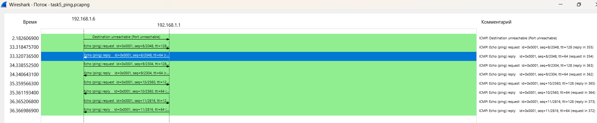
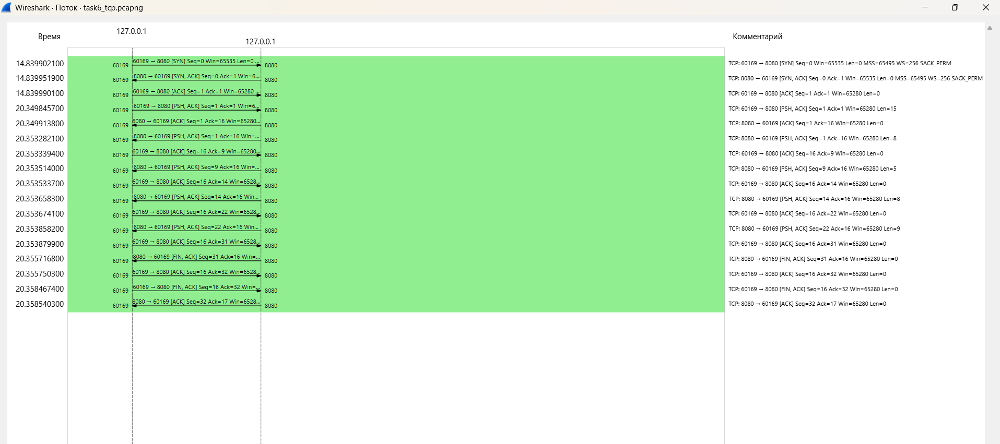
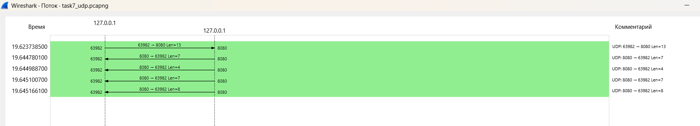

# Лабораторная работа №3

Студент: Корнелюк Яна Максимовна, ИИ-28

**1. Изучить краткие теоретические сведения по возможностям, приемам
работы с программой Wireshark (файл netWS.pdf).**

-Изучила
  
**2. Изучить: типы фильтрации трафика, правила построения фильтров,
приемы статистической обработки сетевого трафика в Wireshark
(материал приведен ниже).**

-Изучила
  

**3. Запустив Wireshark на захват, выполнить загрузку доступной в
лабораторных условиях страницы (bstu.by, iit.bstu.by или др.).
Остановить и сохранить захват. Для захваченных пакетов определить
статистические данные:**
1. процентное соотношение трафика разных протоколов в сети;
2. среднюю скорость кадров/сек;
3. среднюю скорость байт/сек;
4. минимальный, максимальный и средний размеры пакета;
5. степень использования полосы пропускания канала (загрузку сети).

Ответ: 
Процентное соотношение трафика разных протоколов в сети:
- Сетевой уровень: IPv4 — 87.6% пакетов, IPv6 — 0.1% пакетов.
- Транспортный уровень: TCP — 71.4% пакетов, UDP — 16.1% пакетов.
- Прикладной уровень (основные): TLS (зашифрованный HTTPS) — 28.9%, QUIC (Google UDP) — 9.8%, DNS — 4.1%.

Средняя скорость кадров/сек;- 24.1 пакетов в секунду (из строки «В среднем пакетов/с»).

Средняя скорость байт/сек - 30 000 байт/с (30 кБ/с, из строки «В среднем байт/с»).

Минимальный, максимальный и средний размеры пакета:
- Минимальный: 42 байта .
- Максимальный: 13122 байт (обусловлено аппаратным объединением пакетов TSO на сетевой карте).
- Средний: 1259.50 байт.

Степень использования полосы пропускания канала (загрузку сети):
- Скорость: 242 000 бит/с (0.242 Мбит/с).
- Пропускная способност Wi-Fi канала: 144 Мбит/с (144 000 000 бит/с)
- Расчет: (0.242 / 144) × 100% = 0.17%.

  

**4. Отфильтровать в захвате IP пакеты. Определить статистические
данные:**
1. процентное соотношение трафика разных протоколов стека tcp/ip сети;
2. средний, минимальный, максимальный размеры пакета.
3. На примере любого IP-пакета указать структуры протоколов
Ethernet и IP. Отметить поля заголовков и описать их и
интерпретировать их значения.

Ответ:
Процентное соотношение трафика разных протоколов стека tcp/ip сети:
- TCP (Transmission Control Protocol): 81.5% пакетов (2478 шт.).
- UDP (User Datagram Protocol): 18.4% пакетов (559 шт.).

Средний, минимальный, максимальный размеры пакета:
- Минимальный размер: 42 байта.
- Максимальный размер: 13122 байт (обусловлено аппаратным объединением пакетов TSO на сетевой карте).
- Средний размер: 1259.50 байт.

Структура протоколов Ethernet и IP на примере любого IP-пакета:
Заголовок канального уровня (Ethernet II):

- Destination (MAC-адрес получателя): Intel_09:03:d5 (a0:e7:0b:09:03:d5)
- Source (MAC-адрес отправителя): Infinitywire_69:b1:3c (3c:46:45:69:b1:3c)
- Type (Тип): IPv4 (0x0800). 

Заголовок сетевого уровня (Internet Protocol Version 4):

 - Version (Версия): 4. Используется протокол IPv4.
 - Header Length (Длина заголовка): 20 bytes (5).
 - Total Length (Общая длина): 40 байта. .
 - Identification (Идентификатор): 0x53be (21438).
 - Flags (Флаги): 0x2.
 - Fragment Offset (Смещение фрагмента): 0.
 - Time to Live (Время жизни / TTL): 48. 
 - Protocol (Протокол): TCP (6).
 - Source Address (IP-адрес отправителя): 155.102.212.196. 
- Destination Address (IP-адрес получателя): 192.168.1.6. 

  
**5. Запустив Wireshark на захват, выполнить команду ping для IP адреса
соседней рабочей станции в лаборатории (предварительно определив
ее адрес с помощью ipconfig). Сохранить результат. Сформировав
нужный фильтр, отфильтровать пакеты, относящиеся к выполнению
команды ping. На базе полученных пакетов и значений их полей
интерпретировать результат работы утилиты ping. Описать все
протоколы, используемые утилитой. Составить диаграмму
взаимодействия машин при работе утилиты ping. Примечание.
Данная утилита использует протокол ICMP (RFC 792 и RFC 960).**

Интерпретация результатов работы утилиты ping: 
В результате выполнения команды `ping 192.168.1.1` в Wireshark были захвачены ICMP-пакеты. Первый пакет (№23) содержит сообщение `Destination unreachable (Port unreachable)` (служебный ответ), после чего пошёл нормальный обмен. На запросы `Echo (ping) request` шлюз отвечал `Echo (ping) reply`.

Разбор полей на примере захваченного пакета(№34 и №35):

- Источник (Source): 192.168.1.6 — IP-адрес моего компьютера.
- Назначение (Destination): 192.168.1.1 — IP-адрес шлюза.
- Длина (Length): 74 байта (14 байт Ethernet + 20 байт IP + 8 байт ICMP + 32 байта данных) и 74 байта (запрос и ответ).
- Time to Live (TTL): 128 (запрос), 64 (ответ).

Внутри заголовка ICMP:

- Type: 8 (Echo Request) и 0 (Echo Reply).
- Code: 0.
- Identifier (id=0x0001) — идентификатор процесса ping.
- Sequence Number (seq=2048) — порядковый номер пакета, увеличивается с каждым новым запросом.

Описание используемых протоколов:

ICMP (Internet Control Message Protocol): Основной протокол утилиты ping. Работает поверх IP и используется для диагностики сети (передача запросов и ответов).

IP (Internet Protocol): Служит для адресации и маршрутизации ICMP-пакетов между машинами.
Ethernet: Обеспечивает физическую передачу кадров внутри локальной сети.

Диаграмма взаимодействия - `5_graph_flow.png`

  
**6. Запустив Wireshark на захват, выполнить разработанный в
предыдущей лабораторной работе TCP-сервер и TCP-клиент.**

Сохранить результат. Сформировав нужный фильтр, отфильтровать
пакеты данного сеанса. На примере любого TCP-сегмента указать
структуру протокола TCP. Отметить поля заголовка, описать их и
интерпретировать их значения. Составить диаграмму
взаимодействия TCP-сервера и TCP-клиента.

Ответ: 
Установка соединения (Трёхстороннее рукопожатие):
- Пакет 11 (Клиент → Сервер): [SYN]. Порт клиента 60169, порт сервера 8080. Seq=0.
- Пакет 12 (Сервер → Клиент): [SYN, ACK]. Seq=0, Ack=1.
- Пакет 13 (Клиент → Сервер): [ACK]. Seq=1, Ack=1. Соединение установлено.

Передача данных и интерпретация полей TCP:
Выбран пакет №60 (клиент отправляет данные). В заголовке TCP видно:
- Source Port: 60169 (порт клиента).
- Destination Port: 8080 (порт сервера).
- Sequence Number: 1 (начинаем передачу с первого байта).
- Acknowledgment Number: 1 (подтверждаем, что готовы принимать данные от сервера с первого байта).
- Flags: [PSH, ACK]. PSH означает, что приложение отправило данные и просит передать их получателю как можно быстрее. ACK — подтверждение предыдущих пакетов.
Window Size: 65280. Это размер окна (сколько байт данных клиент может принять без подтверждения).
- Length: 15 байт. Длина переданных данных в этом пакете.

Обмен данными:
Далее видно, как сервер отвечает пакетами [PSH, ACK] с данными (Length=8, 5, 8, 9 байт), а клиент подтверждает их получение пакетами [ACK].

Завершение соединения:
- Пакет 70: Сервер отправляет [FIN, ACK].
- Пакет 71: Клиент подтверждает [ACK].
- Пакет 72: Клиент отправляет [FIN, ACK].
- Пакет 73: Сервер подтверждает [ACK]. Соединение закрыто.

Диаграмма - `6_cp_flow.png`

   
**7. Запустив Wireshark на захват, выполнить разработанный в
предыдущей лабораторной работе UDP-сервер и UDP-клиент.
Сохранить результат. Сформировав нужный фильтр, отфильтровать
пакеты данного сеанса. На примере любого UDP-сегмента указать
структуру протокола UDP. Отметить поля заголовка, описать их и
интерпретировать их значения.**

Ответ: 
Анализ заголовка UDP
На скриншоте видно несколько UDP-пакетов между клиентом (порт 63982) и сервером (порт 8080).
- Source Port: 63982 (порт клиента).
- Destination Port: 8080 (порт сервера).
- Length: 45 байт (пакет №11) — из них 8 байт заголовка и 37 байт данных. В столбце Info Wireshark показывает именно длину полезной нагрузки Len=13.
- Checksum: (значение) — контрольная сумма для проверки целостности.
- Важно: Здесь отсутствуют порядковые номера (Sequence), подтверждения (Ack), окна (Window) и флаги (Flags), так как UDP не гарантирует доставку и не следит за порядком пакетов.

Интерпретация работы клиент-серверного приложения:
- Пакет 11 (Клиент → Сервер): клиент отправил сообщение длиной 13 байт.
- Пакеты 12–15 (Сервер → Клиент): сервер ответил несколькими короткими сообщениями (Len=7, 4, 7, 8).
Диаграмма - `7_graph_flow.png`

  
**8. Выполнить анализ ARP-протокола по примеру из методических
указаний.**

Анализ ARP-запроса:

В начале захвата были зафиксированы пакеты ARP-запроса.

- Ethernet-уровень: Destination — Broadcast (ff:ff:ff:ff:ff:ff). Запрос отправляется всем устройствам в локальной сети, так как MAC-адрес получателя неизвестен.

ARP-уровень (пакет №56):

- Opcode: request (1) — тип сообщения «запрос».
- Sender MAC address — MAC-адрес моего Wi-Fi адаптера (3c:46:45:69:b1:3c).
- Sender IP address — 192.168.1.6. (мой IP).
- Target MAC address — 00:00:00:00:00:00 (поле пустое, так как MAC еще не найден).
- Target IP address — 192.168.1.1. (шлюза).

Анализ ARP-ответа:

В захвате присутствуют ARP-ответы от узла с IP 192.168.1.6 (пакет №87):

- Opcode: reply (2) — тип сообщения «ответ».
- Sender MAC address — a0:e7:0b:09:03:d5 (MAC-адрес роутера).
- Sender IP address — 192.168.1.6.
- Target IP address — 192.168.1.1.
- Смысл: В данном захвате мой компьютер отвечал на запросы о своем собственном MAC-адресе (запросы к самому себе).