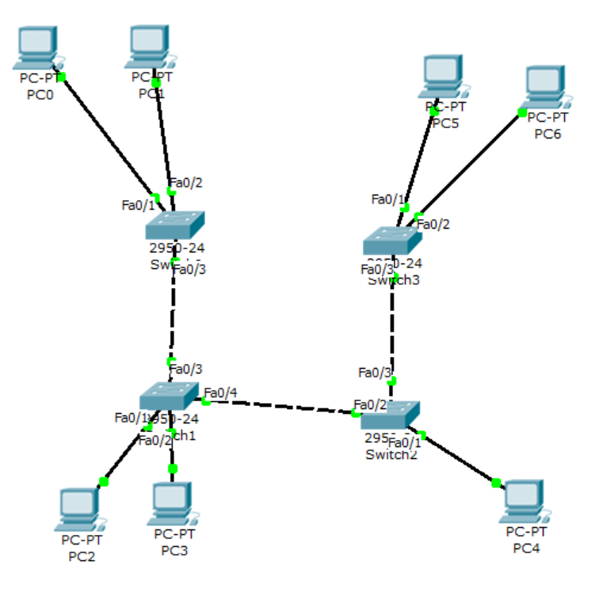
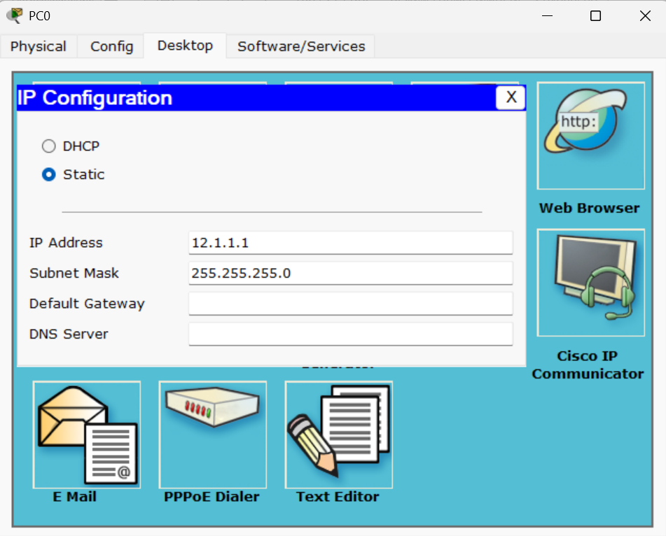
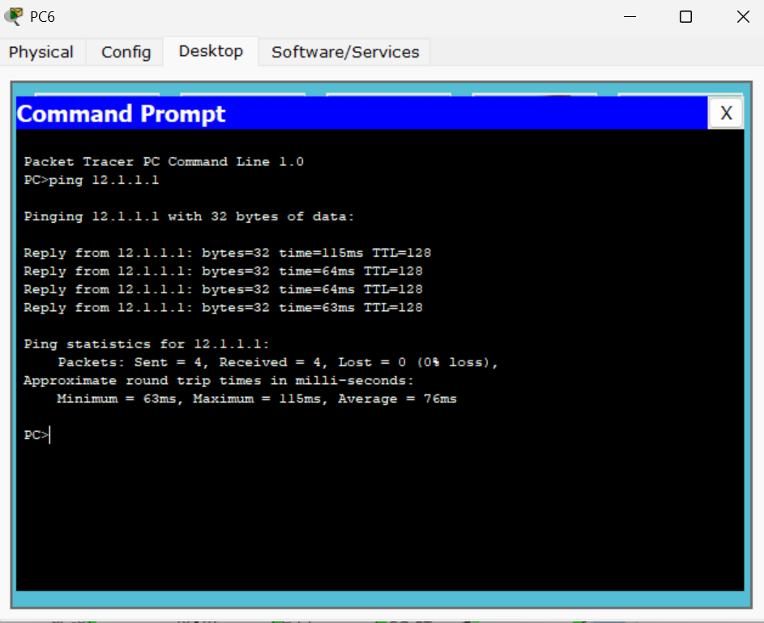
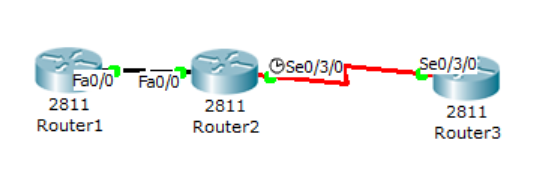
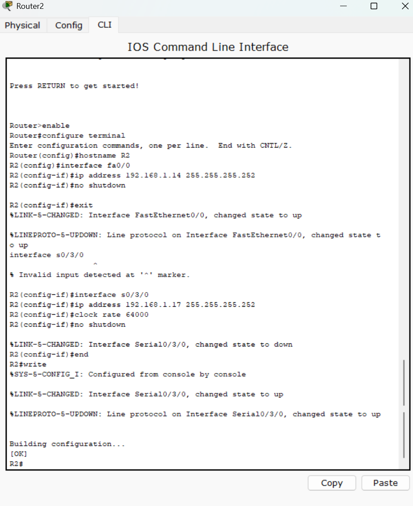
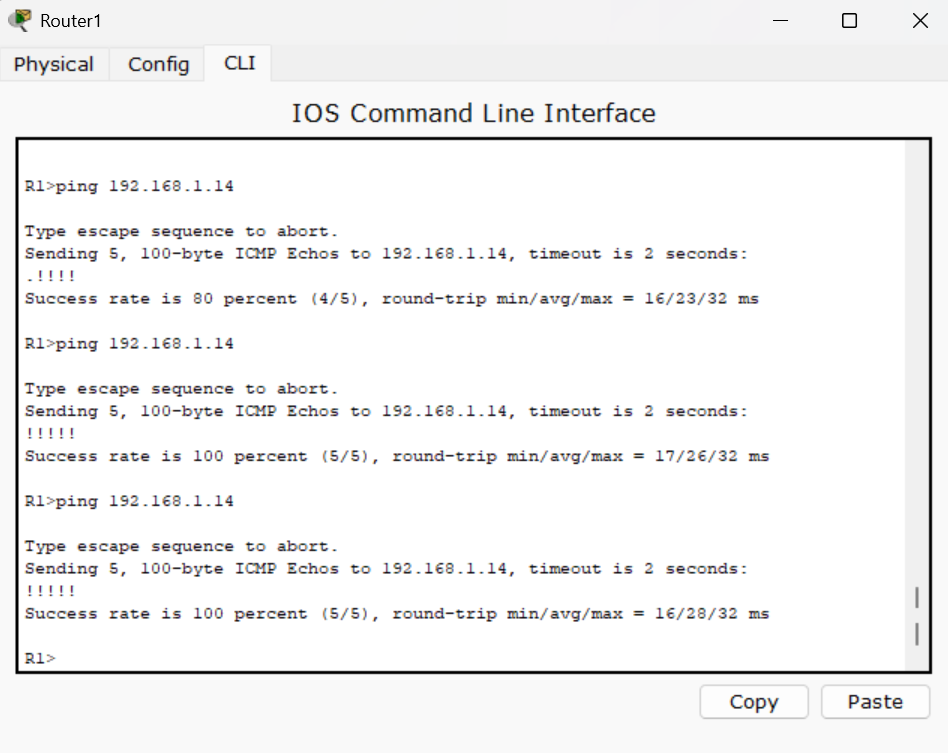

# ЛАБОРАТОРНАЯ РАБОТА 4
**ИЗУЧЕНИЕ ПАКЕТА CISCO PACKET  TRACER. НАЧАЛЬНАЯ КОН-ФИГУРАЦИЯ МАРШРУТИЗАТОРА CISCO**
---

## Часть 1. Локальная сеть

### 1. Топология
Создана топология из 1 коммутатора (Switch 2960) и 7 рабочих станций (PC1 – PC7). Для соединения рабочих станций с коммутатором использован кабель типа Copper Straight-Through.



### 2. ipconfig
```
C:\>ipconfig
FastEthernet0 Connection:(default port)
   Connection-specific DNS Suffix..: 
   IPv4 Address....................: 12.1.1.1
   Subnet Mask.....................: 255.255.255.0
   Default Gateway.................: 
```


### 3. Вывод консоли: проверка связности (ping)
```
C:\>ping 12.1.1.1
Pinging 12.1.1.1 with 32 bytes of data:
Reply from 12.1.1.1: bytes=32 time<1ms TTL=128
Reply from 12.1.1.1: bytes=32 time<1ms TTL=128
Reply from 12.1.1.1: bytes=32 time<1ms TTL=128
Reply from 12.1.1.1: bytes=32 time<1ms TTL=128

Ping statistics for 12.1.1.1:
    Packets: Sent = 4, Received = 4, Lost = 0 (0% loss),
Approximate round trip times in milli-seconds:
    Minimum = 0ms, Maximum = 0ms, Average = 0ms

C:\>ping 12.1.1.4
Pinging 12.1.1.4 with 32 bytes of data:
Reply from 12.1.1.4: bytes=32 time<1ms TTL=128
Reply from 12.1.1.4: bytes=32 time<1ms TTL=128
Reply from 12.1.1.4: bytes=32 time<1ms TTL=128
Reply from 12.1.1.4: bytes=32 time<1ms TTL=128
```



### 4. Разъяснение
- ipconfig: показывает настройки сетевого интерфейса (IP-адрес, маску подсети, шлюз по умолчанию). Шлюз пуст, так как все узлы находятся в пределах одной локальной сети (одного широковещательного домена) и маршрутизация наружу не требуется.
- ping: использует протокол ICMP (Echo Request/Echo Reply). 0% потерь пакетов и минимальное время задержки (<1 мс) подтверждают корректность коммутации на канальном уровне (L2) и правильность IP-адресации на сетевом уровне (L3) между всеми сегментами локальной сети.

<br>

## Часть 2. Конфигурация маршрутизаторов

### 1. Топология
Создана топология из 3-х маршрутизаторов (модель Cisco 2621XM с добавленными модулями WIC-2T).
- R1 и R2 соединены через интерфейсы FastEthernet0/0 кабелем Copper Cross-Over.
- R2 и R3 соединены через интерфейсы Serial0/0/0 кабелем Serial DCE/DTE. Синхронизация (clock rate) задана на стороне DCE (маршрутизатор R2).



### 2. Таблица сетевых адресов
Адреса модифицированы по правилу 192.168.x.y + v (где базовые значения y = 1, 2, 5, 6, а вариант v = 12).


| Устройство | Интерфейс | IP-адрес | Маска подсети | Роль |
| :--- | :--- | :--- | :--- | :--- |
| **R1** | FastEthernet 0/0 | 192.168.0.13 | 255.255.255.252 | DTE |
| **R2** | FastEthernet 0/0 | 192.168.0.14 | 255.255.255.252 | DTE |
| **R2** | Serial 0/3/0 | 192.168.0.17 | 255.255.255.252 | DCE |
| **R3** | Serial 0/3/0 | 192.168.0.18 | 255.255.255.252 | DTE |

### 3. Ход конфигурирования
```
! Настройка R1
enable
configure terminal
hostname R1
interface FastEthernet0/0
ip address 192.168.1.13 255.255.255.252
no shutdown
exit
ip route 192.168.1.16 255.255.255.252 192.168.1.14
exit
write

! Настройка R2 (DCE)
enable
configure terminal
hostname R2
interface FastEthernet0/0
ip address 192.168.1.14 255.255.255.252
no shutdown
exit
interface Serial0/0/0
ip address 192.168.1.17 255.255.255.252
clock rate 64000
no shutdown
exit
exit
write

! Настройка R3
enable
configure terminal
hostname R3
interface Serial0/0/0
ip address 192.168.1.18 255.255.255.252
no shutdown
exit
ip route 192.168.1.12 255.255.255.252 192.168.1.17
exit
write
```



### 4. Вывод консоли: статус интерфейсов и тестирование

Проверка статуса интерфейсов (команда show ip interface brief):

| Устройство | Интерфейс | IP-адрес | OK? | Метод | Статус | Протокол |
| :--- | :--- | :--- | :--- | :--- | :--- | :--- |
| **R1** | FastEthernet0/0 | 192.168.1.13 | YES | manual | **up** | **up** |
| **R2** | FastEthernet0/0 | 192.168.1.14 | YES | manual | **up** | **up** |
| **R2** | Serial0/3/0 | 192.168.1.17 | YES | manual | **up** | **up** |
| **R3** | Serial0/3/0 | 192.168.1.18 | YES | manual | **up** | **up** |

Статус up/up означает, что интерфейс физически включен (no shutdown) и канальный протокол активен.

```
R1#ping 192.168.1.18
Type escape sequence to abort.
Sending 5, 100-byte ICMP Echos to 192.168.1.18, timeout is 2 seconds:
.!!!!
Success rate is 80 percent (4/5), round-trip min/avg/max = 4/7/10 ms
```



Первый пакет (.) может быть потерян из-за процесса разрешения ARP-адреса, последующие 4 пакета успешно доставлены. Это подтверждает, что статические маршруты настроены верно и маршрутизация между подсетями функционирует корректно.